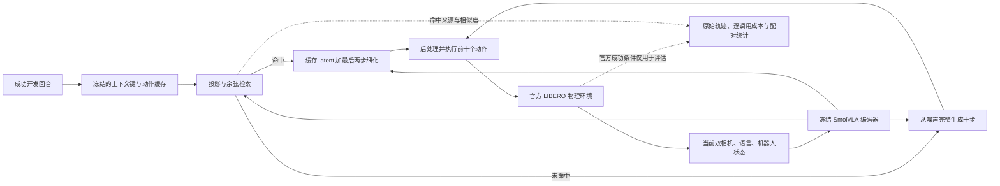

# FeedbackBench

[GitHub 发布范围与文件校验](docs/GITHUB_PUBLICATION.md)：独立私有仓库，代码与可复核证据一并保存。

**这是一个 VLA（视觉—语言—动作）研究项目：输入相机画面、任务指令和机器人状态，输出并执行机器人动作。**

VLM 负责图像与语言的理解，是本项目 VLA 策略中的主干；动作头把这些信息变成机械臂和夹爪的控制命令。我们在 LIBERO 仿真中反复“观察 → 预测动作 → 执行 → 再观察”，检验任务能否完成，以及推理需要多少计算和内存。具体区别、任务例子与结构图见[项目说明：VLA 还是 VLM？](docs/VLA_PROJECT_OVERVIEW.md)。

当前研究主线是 **学习 VLA 的推理计算预算**：冻结公开 SmolVLA，训练小型控制器，根据当前视觉、语言、机器人状态和首步动作特征选择 2／4／10 步采样。按完整任务划分训练、调参、校准和留出评测，用固定预算、随机分配和特征消融检验成功率与实际计算成本。留出仅指本控制器，不声称基础 VLA 预训练未见这些任务。

**2026-10-16 启动两周本机研究周期，最晚 10 月 30 日 14:08（北京时间）停止计算。** 冻结方案覆盖40个官方任务条目：20训练、4调参、4校准、12测试；计划56条采集轨迹、9个控制器检查点、15种方法共360条闭环评测。**2026-10-20 已完成56／56条采集和9／9个控制器训练，全部检查点已冻结，留出闭环评测正在进行。** 采集包含41条官方任务成功和15条完整失败，均保留；这些是训练、调参和校准数据，不是测试成绩。发布数量与快照时间见[修订后的部分研究报告](outputs/learned_compute/v5/report_r1.json)，不是本机实时状态。见[研究协议](docs/LEARNED_COMPUTE_PROTOCOL.md)、[运行与续跑说明](docs/LEARNED_COMPUTE_RUNBOOK.md)和[冻结协议](outputs/learned_compute/v5/protocol.json)。

九个训练配置在预声明的校准规则下均选择**固定4步预算**：满足平均计算预算约束的自适应候选，对10步参考预测的偏差更高。因此当前没有自适应预算收益证据；10步预测也不是正确动作真值。保留全部种子、特征消融和固定／随机对照，按原计划完成360条留出评测，不依据测试结果重新选阈值。训练数据划分、模型与校准选择见[训练汇总](outputs/learned_compute/v5/trained/summary.json)和[冻结训练清单](outputs/learned_compute/v5/trained_manifest.json)。

**报告协议修订 r1（测试开始后修订）**：校准权重求和得到的概率 `1.0000000000000004` 被原报告的严格上界误拒。原随机执行接受该数值，已保存的预算选择经原 RNG 公式重放核对一致。修订仅给报告的概率边界增加 `1e-9` 浮点容差；原始概率、源码、检查点、所有回合和失败记录保留，不重训、不重跑、不改测试分母。原报告及30份源快照、精确差异、验证记录见[冻结的报告修订协议](outputs/learned_compute/v5/reporting_r1/protocol.json)。原 `report.json` 继续作为未修订报告保存，后续统计使用独立的 `report_r1.json`。

真实检查点验证已确认共享首速度后2／4／10步的完整32维输出与原采样器逐值相等；采集三档配对预测共14次动作头计算，部署选K步共K次。见[真实验证凭证](artifacts/learned_compute/real_parity_20261016/report.json)。启动集成阶段的源快照、资源中断和一条76步成功轨迹独立保留；当前v5在加载模型后、构造模拟器前仅回收一次本worker工作集，内存护栏不降低。v4因Windows拒绝替换状态文件而中断，三条完整轨迹（76／72／106步）及原源码独立归档；v5补上原子写入重试及持久I/O错误的进程清理，旧试运行不并入当前分母。

历史研究将 **2026 年 ActionCache 的检索与少步动作细化思路迁移到公开 SmolVLA**，再由缓存负结果开展新初态两步采样确认。另设 **VLA-JEPA（2026）CPU量化与低内存闭环实验**。这些历史结果独立保留，不计入新训练研究的分母。

仅使用现有 **16 GB、无 NVIDIA GPU 的 Windows 电脑，零云费用**。模型权重保持冻结；没有训练基础模型。SmolVLA 是可在本机实验的公开策略，不称其为 2026 最新 SOTA。前沿开放模型及硬件边界见 [FRONTIER_LANDSCAPE](docs/FRONTIER_LANDSCAPE.md)。

**2026-10-16：VLA-JEPA 已在本机成功完成空间、对象、目标三个机器人任务；长程任务也已恢复执行到520步时限，官方判定失败。** 三个成功任务分别执行109、128、90步，并在独立进程中重复得到相同动作与轨迹。长程任务此前在398步因系统余量不足中止；本次在额外[资源准备](docs/VLAJEPA_RESOURCE_RELEASE_RESULTS.md)后重放392步、精确核对6步重叠，再执行122个新动作，完成[严格恢复核验](artifacts/vlajepa-recovery-completion-audit-20261016.json)。本次实际运行19次模型前向（1次边界重算＋18次后续预测）、76次动作头求值，见[恢复结果与录像](docs/VLAJEPA_RECOVERY_RESULTS.md)。

两个5.5GiB四任务阶段仍各为**计划4、完成成功3、未封存1**；原6GiB长任务的398步中断记录也保持不变。恢复完成不增加独立评测样本，不能把不同资源协议、重复执行与恢复拼成同一次4/4或一个总成功率。

实现包含完整词表的分页embedding、256MiB模拟器arena及逐回合独立进程。分页变体在一个保存观察上与原INT8动作逐值相等；[978步保存动作重放](docs/LIBERO_ARENA_REPLAY_RESULTS.md)也保持状态、指定图像和终止标志一致，但**没有证明arena减少物理RSS**。[三个任务两轮执行的审计](artifacts/vlajepa-process-isolation-consistency-20261016.json)逐项核对了48次调用、RNG、动作、状态和图像。真实闭环、单次模型前向与保存动作重放分别统计。

原 owned embedding 的[四任务冻结阶段](docs/VLAJEPA_CLOSED_LOOP_RESULTS.md)保留5GiB启动门槛，现有**四次 `blocked_preflight`**，均未加载权重、四个回合均未开始；最新一次导入后可用4.586GiB。分页实验使用独立协议和目录，不补足原阶段，也不与既有SmolVLA的28回合或16回合合并。闭环接口已通过[47项测试](artifacts/vlajepa-closed-loop-interface-tests.xml)，其中3项使用真实微型PyTorch动态INT8模型；[前台收尾入口](scripts/complete_vlajepa_stage.py)的[首次59项测试](artifacts/vlajepa-stage-completion-tests-20261016.xml)与[文件占用修复后62项测试](artifacts/vlajepa-stage-completion-recovery-tests-20261016.xml)分别保留。测试批次不相加，工程测试不计作机器人任务。

**2026-10-15：新初态前瞻确认 16/16 回合完成，0 缺失、0 运行错误。** 在 8 组配对、4 个任务簇中，full10 成功 **4/8**、noise2 **5/8**；成功差 **+12.5 个百分点，任务簇 bootstrap 95% 区间 [0, 37.5]**。总 action-head NFE 从 **2050 降至 370（−81.95%）**，调用数从 205 降至 185；每回合平均调用耗时的任务等权配对差为 **−5.253 秒 [−10.743, −1.225]**。成功差只来自一个初态，两个长程初态双方均失败；不能据此证明非劣、普遍优越或稳定端到端加速。见[后续研究结果](docs/CONTINUATION_RESULTS.md)、[完整报告](outputs/frontier/flow_confirmation/report.md)及[项目展示指南](docs/PORTFOLIO_GUIDE.md)。

**v1 的 28/28 回合及负结果完整保留。** 其主比较 full10 **7/8**、cache2 **6/8**，成功差 **−12.5pp [−37.5, 0]**；缓存使每调用 NFE 从 10 降至 8.871，但整组总 NFE 仅从 1450 降至 1446。共同 init11 的探索消融中 noise2 为 4/4，由此提出新的确认问题。v1 与新初态的 16 回合分别统计；旧 MINERVA **232 回合**也不混入分母。见[v1 研究结果](docs/RESULTS.md)与[原报告](outputs/frontier/cache_study/report.md)。

## 历史研究阶段

第一阶段检验成功开发回合中的动作中间状态，能否经当前图像、语言和机器人状态检索后，只做最后两步 flow refinement，并保持任务成功。本项目独立实现缓存与采样拆分；原方法归属 [ActionCache 作者论文](https://arxiv.org/abs/2607.06370)。这里采用开发集离线构建、测试冻结的缓存，与论文的在线 LRU 机制不同。

第二阶段在观察到 v1 探索结果后，先固定 init41/43、full10/noise2 对照和分析规则，再执行 16 回合。noise2 从新噪声走完整 flow 时间区间，不读取缓存。评估范围为四个 suite 各 task1、各两个初态；控制步上限分别为 280/280/300/520，不是完整官方 benchmark，也不证明上游预训练未见这些初态。

| 证据层次 | 状态与入口 |
|---|---|
| 采样语义验证 | 真实 SmolVLA 权重、相同噪声下，完整 10 步和第 8 步保存后续算 2 步，均与上游逐位一致；[真实测试记录](artifacts/cache-sampler-real-parity.xml) |
| CPU 成本拆解 | 当前观测编码和动作头分别计时；完整调用三次中位 10.202 秒，仍有明显负载波动；[实测与限制](docs/FRONTIER_CPU_PROFILE.md) |
| v1 多任务闭环 | **28/28 完成，0 错误、0 缺失**；4 个开发回合，8 对主比较，4 对四方法消融，重叠回合不重复计算；[冻结协议](docs/CACHE_PROTOCOL.md)、[完整统计](outputs/frontier/cache_study/report.md) |
| 前瞻确认 | **16/16 完成，8 对、4 任务簇**；初态 41/43，full10 4/8、noise2 5/8；[预声明协议](docs/FLOW_CONFIRMATION_PROTOCOL.md)、[完整统计](outputs/frontier/flow_confirmation/report.md)、[图表](outputs/frontier/flow_confirmation/figures/flow_success_budget.png) |
| VLA-JEPA 原生 BF16 | 官方 6.16 GB checkpoint 已完整下载并校验；[本次重试](artifacts/frontier/vlajepa_bf16_probe_20261015.json)因 **5.887 GiB < 固定 6 GiB 门槛**退出，没有构造、加载或前向；[历史记录](artifacts/frontier/vlajepa_real_probe.json)保留 |
| VLA-JEPA 动态 INT8 | [一次真实观测前向通过](artifacts/frontier/vlajepa_int8_probe_20261015.json)，300/300 个量化 Linear 实际执行，四步 action head，输出 `(1,7,7)`；单次前向 **6.954s**，1秒采样最高 RSS **3.521GiB**。这是[独立数值变体](docs/CPU_VLAJEPA_INT8.md)的可行性证据，不证明稳定延迟、原生等价或闭环质量 |
| VLA-JEPA 分页存储 | [真实单观测探针](artifacts/frontier/vlajepa_paged_probe_20261016.json)与原INT8动作逐值相等，采样最高RSS **2.929GiB**；首次分页闭环因系统可用内存 **0.447GiB** 中止，0动作、1未封存、3缺失；[结果与限制](docs/VLAJEPA_PAGED_RESULTS.md) |
| VLA-JEPA 实际闭环 | [compact](docs/VLAJEPA_COMPACT_RESULTS.md)及[独立进程](docs/VLAJEPA_ISOLATED_RESULTS.md)各完成成功3项，长程项未封存；[独立6GiB长任务](docs/VLAJEPA_LONG_HORIZON_RESULTS.md)保存398步后中止。后继[恢复执行](docs/VLAJEPA_RECOVERY_RESULTS.md)已到520步，**完整执行、官方任务失败**，不改写原阶段结果 |
| 保存动作重放 | spatial/init43/noise2 的 [280步重放与只读复核](outputs/replays/flow-spatial43-noise2/flow_replay_audit.json)通过：281个8维机器人状态、初始双相机和末帧像素、终止/失败标志一致；没有新模型调用，不增加评估分母 |
| 已保存的基础实验 | MINERVA 四阶段 **232 回合**完成；原计划余下 16 回合未尝试，见[阶段变更记录](outputs/campaign/TRANSITION.md) |
| 验证 | 后续完整单元测试 **566 passed、1 skipped，95.09s**，包含两项实际 INT8/BF16 小算子测试；[当前 XML](artifacts/continuation-unit-tests.xml)。原始 16 回合、报告只读重算及新重放复核通过。v1 [419 passed、1 skipped 历史 XML](artifacts/frontier-unit-tests.xml)单独保留；另行模型接入测试不加总 |

四个闭环条件是完整 10 步、纯噪声 2 步、缓存中间状态后细化 2 步，以及直接复用缓存最终动作。所有条件使用同一个当前观测编码器、固定每 10 步重规划；缓存 miss 回退完整推理，测试标签不参与更新。成功率、实际 NFE、编码/动作头/检索/完整调用耗时与失败案例一起报告，不预设检索方案一定有效。

## 保留的反馈调度基线

固定每 1 / 4 / 8 / 15 步重新预测动作，与根据视觉变化和夹爪状态变化触发预测相比，成功率和实际推理调用有什么变化？时间集成是否有帮助？观察延迟是否改变结论？

自适应策略是待检验的简单启发式，不能预设其优于固定间隔。任务编号策略与语言条件策略分别报告。相关工作见 [RELATED_WORK](docs/RELATED_WORK.md)，实验原则见 [PROTOCOL](docs/PROTOCOL.md)。

项目讲解、面试问题与可用证据见 [PORTFOLIO_GUIDE](docs/PORTFOLIO_GUIDE.md)，上游成果归属见 [THIRD_PARTY](docs/THIRD_PARTY.md)。
已观察到的失败现象与待验证假设见 [FAILURE_ANALYSIS](docs/FAILURE_ANALYSIS.md)；事后分析不参与开发集选参。

已完成的 [40 任务覆盖诊断](docs/COVERAGE_RESULTS.md) 为 **37/40 成功**：Spatial 10/10、Object 10/10、Goal 9/10、LIBERO-10 8/10，无运行异常。每任务仅一个初态，不能当作论文等规模成绩；调度效果要由独立的开发与保留实验回答。

[32 回合开发实验](docs/DEVELOPMENT_RESULTS.md) 已完成并选定 `adaptive_low`。它与 fixed8 均为 8/8 成功，但平均调用多 33.1%；被规则选中并不等于优于基线，保留实验使用这个已冻结设置继续检验。

[128 回合主比较与消融](docs/METHOD_RESULTS.md) 已完成：每方法 8 个任务、2 个初态，共 16 回合。自适应为 **15/16 成功**，fixed8 为 **16/16**；成功率差为 −6.25 个百分点，任务簇 95% 区间为 [−18.75, 0]，平均调用增加 **93.1%**。干净观测结果不支持候选自适应规则改善权衡。另有 32 回合观察延迟实验完成，见[延迟报告](outputs/campaign/40_delay/report.html)。这些 MINERVA 结果不归入新 SmolVLA 缓存实验的分母。

## 公开模型与基准

| 组件 | 作用 | 使用边界 |
|---|---|---|
| [MINERVA](https://github.com/k1000dai/MINERVA) 0.54M L1 | 轻量双相机、机器人状态、任务 ID 策略；承担多任务评测 | 不是语言泛化模型；15 个未来动作 |
| [SmolVLA LIBERO](https://huggingface.co/HuggingFaceVLA/smolvla_libero) | 双相机、机器人状态和语言条件的公开 VLA | 该检查点约 0.605B 参数条目，CPU 成本需实测 |
| [VLA-JEPA LIBERO](https://huggingface.co/lerobot/VLA-JEPA-LIBERO) | 固定LeRobot端口的预训练VLA，四步flow动作头 | 本项目使用独立CPU动态INT8变体，原生BF16没有运行对照；不宣称完整官方成绩复现 |
| [LIBERO](https://github.com/Lifelong-Robot-Learning/LIBERO) | Spatial / Object / Goal / LIBERO-10 四套操作任务 | 公开成功判据和初始状态；不把模拟结果当真机结果 |

代码固定于 MINERVA commit `64c3cc8be364eb62df4f9fdc4bdccb1be9d1118e`。模型、归一化器、分词器与资产均固定 revision 并校验上游哈希。MuJoCo 固定 **3.3.2**。完整运行会把源码、配置、依赖、资产和权重指纹写入输出目录。

## 本机启动

使用 Python 3.12、Git、CPU 和约 16 GB 内存。运行期间需要 OpenGL 渲染支持。

```powershell
# 首次安装：独立 .venv，不修改其他项目
python scripts/bootstrap.py --download
# 国内网络较慢时，可显式指定镜像
python scripts/bootstrap.py --index-url https://pypi.tuna.tsinghua.edu.cn/simple --download

# 无检查点的协议与代码测试；真实权重接入另测
python scripts/run.py -m pytest tests --ignore=tests/test_policies.py --ignore=tests/test_smolvla_loading.py -q
python scripts/run.py scripts/smoke_simulator.py

# 先完成一个完整时长的集成回合
python scripts/run.py -m embodied_research run --plan plans/00_smoke.json --output outputs/smoke
python scripts/run.py -m embodied_research report --output outputs/smoke

# 重新运行新的缓存研究，保留本次原始证据
python scripts/run.py scripts/run_cache_study.py --output outputs/reproduction-cache
python scripts/run.py scripts/summarize_cache_study.py --output outputs/reproduction-cache

# 单独复现新初态的 full10 / noise2 前瞻确认
python scripts/run.py scripts/run_flow_confirmation.py --output outputs/reproduction-flow-confirmation
python scripts/run.py scripts/summarize_flow_confirmation.py --output outputs/reproduction-flow-confirmation
```

VLA-JEPA 的环境与下载是独立的可行性支线：`python scripts/run.py scripts/probe_vlajepa.py fetch --connections 4` 获取固定官方源码与检查点，`python scripts/run.py scripts/probe_vlajepa.py run --output outputs/reproduction-vlajepa.json` 做一次真实观测前向。加载前要求至少 6 GiB 可用内存；不满足时明确记录阻碍。该命令不是 LIBERO 闭环评测，且应与其它模型进程串行运行。

独立 INT8 变体可用 `python scripts/run.py scripts/probe_vlajepa_int8.py --threads 2 --output artifacts/frontier/vlajepa_int8_repeat_01.json` 复现，要求新的输出名及固定内存门槛。它使用动态 INT8 Linear、BF16 embedding 存储并将其输出转为 FP32，其余推理部分为 FP32；内核还会量化激活，不能简称 W8A32。本次单观测前向通过不等于原生 BF16 质量保持或相对原生加速。

已冻结的四回合闭环可用 `python scripts/run.py scripts/complete_vlajepa_stage.py --wait-seconds 600` 在前台续跑：最多等待600秒达到5GiB可用内存，之后串行执行原runner、生成报告并严格核验。等待超时、缺失、未封存、运行错误或锁冲突均返回非零；默认不等待，不创建后台任务，也不停止其它项目。部分或错误回合保留并要求检查，不能自动覆盖重跑。私有操作日志另存于 `.runtime/closed_loop_completion/`，实际回合证据仍在原输出目录。

分页与受审计 arena 的单进程阶段由 `run_vlajepa_compact.py` 管理；每回合独立进程的四任务矩阵由 `run_vlajepa_isolated.py` 管理。后者实际仍有一个未封存回合。对本机原始记录，须显式允许部分核验；不带 `--partial` 会正确拒绝把它认作完整实验：

```powershell
python scripts/run.py scripts/run_vlajepa_isolated.py validate --partial
```

GitHub发布副本的少数运行诊断已清除本机路径，因此其字节哈希与本机原件不同；worker及原始审计中的哈希仍保留原值。对发布快照先运行 `python scripts/verify_publication.py`：它校验导出字节、冻结源和回合receipt，并明确区分原件哈希与经清单映射的诊断副本，不把脱敏文件冒充原始字节。动作、轨迹、回合结果与receipt未经修改。详见[发布说明](docs/GITHUB_PUBLICATION.md)。

如需独立复现，使用一个从未执行过的新目录，按顺序冻结、执行和严格校验；旧尝试、任务分母及失败记录均保留：

```powershell
python scripts/run.py scripts/run_vlajepa_isolated.py freeze --output outputs/reproduction/vlajepa-isolated-01
foreach ($episode in 1..4) {
    python scripts/run.py scripts/run_vlajepa_isolated.py run-one --output outputs/reproduction/vlajepa-isolated-01
    if ($LASTEXITCODE -ne 0) { throw "Episode process failed; preserve its evidence and inspect it before continuing." }
}
python scripts/run.py scripts/run_vlajepa_isolated.py validate --output outputs/reproduction/vlajepa-isolated-01
```

入口会重验已保存的单观测模型一致性与四任务环境重放证据，随后才允许加载。每个 `run-one` 必须使用新 Python 进程；每次最多完成一回合，已封存回合只读核验后跳过。`report` 可生成部分结果，但只有严格 `validate` 能确认四回合及独立进程账本完整；缺失、未封存或运行错误不能当作通过。启动预算 3.5GiB 是探索性门槛，实际共同驻留仍可能触发 0.5GiB 系统余量保护，不能据此承诺任何时刻均可运行。见[进程隔离协议](docs/VLAJEPA_ISOLATED_PROTOCOL.md)与[978步环境重放](docs/LIBERO_ARENA_REPLAY_RESULTS.md)。

长程任务的独立6GiB预算只计划一回合，不导入旧成功，也不改变旧矩阵。复现使用新的目录：

```powershell
python scripts/run.py scripts/run_vlajepa_long_horizon.py freeze --output outputs/reproduction/vlajepa-long-01
python scripts/run.py scripts/run_vlajepa_long_horizon.py run --output outputs/reproduction/vlajepa-long-01
python scripts/run.py scripts/run_vlajepa_long_horizon.py validate --output outputs/reproduction/vlajepa-long-01
```

该入口在导入前和加载前要求5.75GiB系统可用内存，运行时保留0.5GiB余量保护；实际占用与结果见[独立报告](docs/VLAJEPA_LONG_HORIZON_RESULTS.md)。中止记录不可覆盖重跑。Windows文件占用的有限重试与独立终态有[62项历史测试](artifacts/vlajepa-stage-completion-recovery-tests-20261016.xml)；该[早期闭环审计](artifacts/closure-audit-20261016.json)只描述当时的阻断，不代表后续阶段状态。状态日志修复不构成机器人任务结果。

长任务另有已冻结的[中断恢复入口](docs/VLAJEPA_RECOVERY_RESULTS.md)，绑定原398步证据。本次第六次启动在额外资源管理辅助下完成392步重放、6步重叠精确核对和122步新执行；严格`validate`返回0，官方成功为false。前五次预检阻断全部保留，恢复实现的75项历史定向测试与实际模型结果分开记录。以下入口依赖本机未脱敏原始证据；已封存结果不会再次执行模型。发布副本的完整性使用上述`verify_publication.py`核验，重新开展独立实验须采用新的输出与独立协议。

```powershell
python scripts/run.py scripts/run_vlajepa_recovery.py run
if ($LASTEXITCODE -ne 0) { throw "Recovery did not complete; preserve and inspect its evidence." }
python scripts/run.py scripts/run_vlajepa_recovery.py report
python scripts/run.py scripts/run_vlajepa_recovery.py validate
```

恢复不增加独立评测样本，不回填原中止目录，也不能与前三项成功拼成同协议4/4。

单个计划的 `Run.ps1 run`（或 `feedbackbench run`）支持 `--limit N`，在该计划累计完成 N 个回合后正常退出；完整流程脚本 `run_campaign.py` 不接受此参数。再次使用相同命令会继续未完成回合；源码、依赖、计划或权重改变时，必须使用新的输出目录。错误记录会保留并停止运行，不能自动丢弃失败案例。

Windows 环境实际保存在本机 `%LOCALAPPDATA%/FeedbackBench/`，项目内 `.venv` 是目录连接。`Run.ps1` / `scripts/run.py` 保留短路径，避开官方长任务文件名与 OneDrive 对运行环境的干扰；没有修改系统长路径设置。

上面的 Python 命令不依赖 PowerShell 脚本执行权限。`Run.ps1` 是执行策略允许时的便捷入口；无需为本项目更改系统执行策略。

安装与计时细节见 [RUNTIME](docs/RUNTIME.md)。默认完整测试会真实加载模型，耗时及内存明显高于纯单元测试；CI 只运行不需要权重的协议、统计和适配器测试，模型接入验证单独记录。

`run_campaign.py --output outputs/reproduction --through development` 可在开发集选参后结束；再次使用同一输出目录运行完整命令继续后续阶段。计划、生成器、选择规则及核心源码在首个阶段前冻结；正式比较计划只在开发集选择完成后生成和冻结。每阶段报告与总览保存在指定输出目录；省略 `--output` 时默认为 `outputs/campaign/`。

`outputs/campaign/` 保存旧计划中已完成的四阶段，原始状态文件保留了退出前的值；实际停止和未运行部分见 [TRANSITION](outputs/campaign/TRANSITION.md)。查看 HTML 不需要安装模型；`python scripts/run.py scripts/rebuild_reports.py --completed-only` 只重建这些完整阶段，不执行机器人回合。要复现旧设计，可显式运行 `python scripts/run.py scripts/run_campaign.py --output outputs/reproduction-baseline`，不要覆盖原始目录。

证据包也包含推理测量所用的真实双相机观测。安装并下载模型后，可用 `python scripts/run.py scripts/profile_policy.py --policy smolvla --observation artifacts/policy_smoke_observation.npz --output outputs/reproduction-profile.json` 在相同输入上重新测量。它仅测量动作块推理，不执行完整任务，也不应覆盖随包附带的原始 profile。

## 项目结构

```text
src/embodied_research/
  runtime.py       固定版本与可审计的 Windows 兼容
  simulator.py     官方 LIBERO reset、相机、动作与成功判据
  policies.py      严格加载公开权重，保持原始处理器和历史队列
  cache_sampler.py 当前 VLM 上下文、原始 flow 网格与中间状态续算
  action_cache.py  稀疏投影、不可变缓存、来源与完整性校验
  cache_policy.py  四条件、噪声对齐与逐调用 NFE/耗时记录
  scheduling.py    固定间隔、视觉/夹爪触发、时间集成
  experiment.py    配对初态、协议指纹、恢复和逐回合证据
  statistics.py    任务等权统计、配对比较、任务簇 bootstrap
  reporting.py     离线 HTML、PNG/SVG 图表及原始记录链接
plans/            实验输入，运行前固定
scripts/          安装、下载、完整性和真实环境验证
tests/            因果性、对齐、统计分母与报告验证
outputs/          本机实验产生，不由代码虚构
```

每个回合保存 `result.json`、`trajectory.npz`、初始双相机图像、最终图像；预先指定的回合还保存录像。任务状态真值只用于官方成功判定，不进入策略或调度器。



图示为主比较中的 `cache2` 路径。`full10` 对照始终从噪声生成；`noise2` 与 `cache0` 分别隔离粗网格少步生成和不经细化的直接复用。测试回合不会写入冻结缓存。

生成证据包：`python scripts/run.py scripts/package_results.py --frontier --output deliverables/feedbackbench-frontier.zip`。它要求新研究 28 回合及旧基线四阶段完整，并明确标出旧计划的 16 个未运行回合；包含代码、协议、缓存、报告、图表、轨迹与录像，校验 ZIP 和逐文件哈希，不复制权重、环境或仿真资产。已有同名包时拒绝覆盖，复现应使用新文件名。默认不带 `--frontier` 的旧打包入口仍要求原 248 回合全部完成，不能用来掩盖未运行阶段。

后续证据包入口为 `python scripts/run.py scripts/package_results.py --continuation --output deliverables/feedbackbench-continuation.zip`，额外要求新的 16 回合及报告完整，保留 232 / 28 / 16 的独立范围，并按实际状态收录模型探针与诊断重放。闭环报告、当前测试、INT8 单次前向及新重放已有实际证据；归档交付以实际 ZIP、旁置 SHA 和独立核验记录为准，生成命令本身不表示归档已通过审核。已有 v1 包保持不变。

新包在 `feedbackbench/` 下组织 `README.md`、`docs/`、`src/`、`scripts/`、`tests/`、原始 `outputs/` 与选定 `artifacts/`，由 `BUNDLE_MANIFEST.json` 列出各研究范围和逐文件 SHA。权重、运行环境及仿真资产不装入归档；ZIP 内容、当前来源哈希、隐私和相对链接须在交付时独立核查。

## 解释结果时的边界

- 仿真在推理期间暂停。推理次数、CPU 耗时、模拟时间分别报告；人工加入的 4 步观察延迟不等于真实异步执行。
- 成功会提前结束回合，因此同时报告每回合调用数、每百步调用率、步数及成功率。
- 保留初态不等于模型未见任务；一个固定检查点不代表多个训练随机种子。
- 少量任务上的区间可能很宽。论文成绩不能与本机少量初态、Windows 移植结果直接排名比较。
- 原始模型和作者的成果明确归属上游。本项目的可展示贡献是实验系统、严格验证和由真实结果支持的分析。
