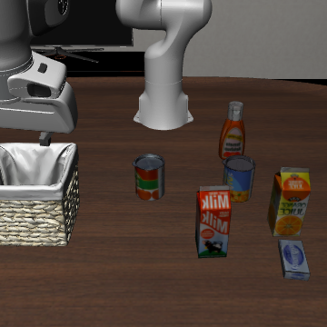

# FeedbackBench 后续研究：新初态前瞻确认结果

**后续支线（2026-10-16）：** VLA-JEPA已产生独立的真实闭环证据，见[进程隔离结果](VLAJEPA_ISOLATED_RESULTS.md)与[单长任务资源实验](VLAJEPA_LONG_HORIZON_RESULTS.md)。本页继续只报告既有SmolVLA的16回合前瞻确认，不将后来的任务加入其分母。

**2026-10-15：前瞻确认 16/16 回合已完成并封存，0 缺失、0 未封存、0 运行错误。** 本页依据[正式报告](../outputs/frontier/flow_confirmation/report.md)、[报告 JSON](../outputs/frontier/flow_confirmation/report.json)与逐回合原始证据。当前整套单元测试、报告只读重算及保存动作重放复核已通过；VLA-JEPA 动态 INT8 变体完成一次真实观测前向，原生 BF16 重试仍在内存门槛前退出。两者都不计入闭环评测分母。v1 结果继续以[原结果页](RESULTS.md)和[原报告](../outputs/frontier/cache_study/report.md)为准。

**noise2 成功 5/8，full10 成功 4/8；总 action-head NFE 从 2050 降至 370。** 任务等权成功差为 **+12.5 个百分点，4 个任务簇的 bootstrap 95% 区间 [0, 37.5]**。这组样本中没有 noise2 独自失败的配对，唯一成功差来自 object/init41；两个 LIBERO-10 初态双方都失败。结果显示该指定范围内更低的动作头预算和一个额外成功，不证明普遍优越、非劣或稳定端到端加速。

项目在同一台 16 GB、无 NVIDIA GPU 的 Windows 电脑上运行，零云费用。研究线检验冻结预训练策略的推理预算与闭环结果；VLA-JEPA 支线检验公开前沿模型的本机运行边界。两类证据回答不同问题，分别报告。

## 从负结果提出一个新的可检验问题

v1 将 ActionCache 的检索与少步细化思想独立迁移到 SmolVLA，采用成功开发回合建库、测试冻结的离线缓存。在 8 组主比较中，full10 成功 **7/8**、cache2 成功 **6/8**。缓存每调用 action-head NFE 从 10 降至 8.871，但整组总 NFE 仅从 1450 降至 1446；结果没有支持“保持任务成功并稳定加速”。方法归属与迁移差异见[原研究说明](RESULTS.md)。

共同 init11 的探索消融提供了下一项假设：full10 与直接从噪声生成的 noise2 都为 **4/4**，两种缓存条件均为 **3/4**。这是选择后续问题的探索性证据，不能事后改称为预先选定 noise2 的确认结果。新试验据此先固定协议，再检验：在未用于本项目先前评估的初态上，覆盖完整 flow 时间区间的两步粗网格采样，是否仍保持观察到的任务成功，同时减少动作头计算。

本阶段没有增加动作缓存门控、事后阈值调优或新算法首创声明。研究价值在于预先固定下一项问题、完成匹配对照，并同时公开成功、失败、调用数与成本。

## 三个实验范围分别计数

| 范围 | 状态 | 回合与统计单位 | 证据入口 |
|---|---|---|---|
| MINERVA 原基线 | 已完成四阶段 | **232 回合**；保留原阶段的各自分母 | [基线结果](BASELINE_RESULTS.md)、[阶段变更](../outputs/campaign/TRANSITION.md) |
| ActionCache–SmolVLA v1 | 已完成 | **28 回合**：4 开发、16 主比较、8 新增探索条件；主比较 8 对、4 任务簇 | [结果](RESULTS.md)、[冻结协议](CACHE_PROTOCOL.md) |
| full10 / noise2 前瞻确认 | 已完成 | **16 回合**：每方法 8 回合、共 8 对、4 任务簇；初态 41/43 | [预声明协议](FLOW_CONFIRMATION_PROTOCOL.md)、[实际冻结文件](../outputs/frontier/flow_confirmation/protocol.json) |
| VLA-JEPA BF16 / INT8 探针 | BF16门槛阻断；INT8一次前向通过 | 一批真实观测前向；**不是闭环评测回合** | [BF16实际记录](../artifacts/frontier/vlajepa_bf16_probe_20261015.json)、[INT8实际记录](../artifacts/frontier/vlajepa_int8_probe_20261015.json) |
| 保存动作的仿真重放 | 新旧两次诊断均已验证 | **不增加策略评估回合或独立成功率样本** | [已有 FA-001 审计](../outputs/replays/fa-001/replay_audit.json)、[新重放审计](../outputs/replays/flow-spatial43-noise2/flow_replay_audit.json) |

原 MINERVA 计划余下 12 个 SmolVLA 回合及 4 个 flow-step 回合仍是**未尝试**。它们与当前新协议的 16 回合不是同一计划，不能因数量恰好相同就标成旧计划已完成。以上范围不合成一个总成功率；v1 消融中重复使用的 full10/cache2 回合也不重复累加。

## 前瞻确认的固定口径

实际协议指纹为 `813efc115c410af42323fb9a7be4ed0b7f1fb474fcfaa227d483fc7b830fda84`。四个 LIBERO suite 各 task1，每个任务初态 41/43，比较同一 SmolVLA 检查点下的 full10 与 noise2。初态仅对本项目是新的，不证明从上游训练数据中排除，也不是未见任务泛化实验。

两个条件都使用当前观测的 VLM、相同配对决策序号的噪声、每 10 个控制步重规划，运行到成功终止或冻结上限：spatial **280**、object **280**、goal **300**、LIBERO-10 **520** 个控制步。这里只覆盖四个 suite 各 task1 的指定初态，不是全套官方 benchmark。noise2 从噪声覆盖完整 flow 时间区间；它与缓存 latent 从 `t=.2` 续算最后两步不同。CPU 两个计算线程、一个 inter-op 线程、图像 360、seed=1000 等定义已经冻结，不能按中途结果更改。

| 指标 | 固定统计口径 | 实际结果 |
|---|---|---|
| 成功率差 | noise2 − full10；先按任务内两个初态求均值，再对四任务等权 | **+12.5pp [0, 37.5]** |
| 区间 | 2,000 次任务簇 bootstrap，seed=20261015；只有 4 个任务簇 | 区间不稳定，包含 0 不证明等价或非劣 |
| action-head 预算 | 每调用 NFE、调用总数、总 NFE 分开列出 | 见下表；NFE 不包含 VLM 成本 |
| 完整调用耗时 | 每回合调用均值的任务等权配对差 | **−5.253s [−10.743, −1.225]**；不同轨迹不是同输入微基准 |
| 回合 wall 时间 | 仅双方成功配对的差作条件化描述，不给总体加速倍数 | **4 对，均值差 −111.436s**；不计算区间，全部回合 wall 公开 |
| 首 10 个动作命令差 | 后处理后、环境内部限幅前，按通道报告；不足 10 步标缺失 | **8 对有效、0 缺失**；混合七维 RMSE 均值 **0.036213**，不是任务质量或整个动作块误差 |

| 全部 8 回合的指标 | full10 | noise2 |
|---|---:|---:|
| 成功 | 4/8 | 5/8 |
| 重规划调用 | 205 | 185 |
| 总 action-head NFE | 2050 | 370 |
| NFE / 调用 | 10 | 2 |
| 完整调用池 p50（秒） | 12.222 | 7.919 |
| 完整调用池 p95（秒） | 41.390 | 72.451 |

每调用动作头预算下降 **80%**，整组总 NFE 下降 **81.95%**；后者还包含调用数下降的影响。它们不是系统加速倍数。调用池 p95 在 noise2 下反而更高，与配对回合均值的降低并不矛盾：权重不同、闭环输入分化且共享主机负载变化。这一轮不能证明稳定部署尾延迟改善。


原始结果生成报告前已通过冻结 runner 的完整封存校验。[报告器](../scripts/summarize_flow_confirmation.py)导出[分组](../outputs/frontier/flow_confirmation/groups.csv)、[全部回合](../outputs/frontier/flow_confirmation/episodes.csv)、[配对](../outputs/frontier/flow_confirmation/pairs.csv)、[逐调用](../outputs/frontier/flow_confirmation/calls.csv)和 PNG/SVG；[exports.json](../outputs/frontier/flow_confirmation/exports.json)最后写入并绑定导出 SHA。独立执行 `--validate-only` 已通过完整16回合核查，并重算统计、Markdown 与 CSV；最终打包会再次校验。本页不会代替原始证据和只读验证。

## 失败与共享负载下的计时边界

8 组配对中有 **4 对双方成功、3 对双方失败、1 对仅 noise2 成功**。双方失败包含 spatial/init43，以及 LIBERO-10/init41 和 init43；长程四回合均运行至冻结的 **520 步**，没有因耗时长而截断。观察成功差全部来自 object/init41（noise2 成功、full10 失败），不代表更广任务分布中的优势。

两个较慢 noise2 回合的分项计时不同，单位均为秒：

| 回合 | wall | `policy_inference_seconds` | `simulator_seconds` | 原始记录 |
|---|---:|---:|---:|---|
| spatial/init43 | 2237.266 | 207.877 | 2022.183 | [result.json](../outputs/frontier/flow_confirmation/episodes/smolvla__libero_spatial__1__43__clean__noise2/result.json) |
| LIBERO-10/init41 | 2144.280 | 1889.533 | 235.090 | [result.json](../outputs/frontier/flow_confirmation/episodes/smolvla__libero_10__1__41__clean__noise2/result.json) |

前者主要计入 simulator，后者主要计入策略推理，不能统一归因为仿真。它们是实际阶段墙钟记录，不是 CPU 占用时间，也不确定具体外部进程是原因。同步仿真在推理时暂停；20Hz 控制周期不意味着本机实时推理。

LIBERO-10/init41 的任务是将奶油奶酪盒和黄油都放入篮子。下图中，蓝色奶油奶酪盒仍在桌面右下方、篮子在左侧，至少该目标物未入篮，与 `success=false` 一致。遮挡使另一物体的状态不明确，不能由末帧推断完整动作原因。



spatial/init43/noise2 的[保存动作重放](../outputs/replays/flow-spatial43-noise2/flow_replay_audit.json)已得到 `passed_exact_replay`，并通过独立只读复核。280 个保存动作，以及初始加每步共 **281 个8维机器人本体状态**逐项完全相同；初始正面/手腕图像与终止正面图像像素相同，终止与成功标志一致，仍为失败。原始封存证据未变，**没有调用模型、没有新增评估回合**。这不是对完整物理世界状态或全部中间图像的等价声明。[重放录像](../outputs/replays/flow-spatial43-noise2/base/replay.gif)与[保存的重放轨迹](../outputs/replays/flow-spatial43-noise2/replayed_trajectory.npz)可独立查看。

重放 helper 耗时 **134.238秒**，包括reset、渲染和GIF编码；其中包裹 `simulator.step` 的计时合计 **72.258秒**。原正式回合wall为2237.266秒，包含策略推理等不同工作；两个总时间不能直接相除当作加速倍数。原simulator计时2022.183秒与重放step计时72.258秒，帮助定位阶段计时异常，但不足以识别具体外部负载的因果影响。重放一致也不改变正式失败或证明方法质量。

## 原生 BF16 与 INT8 支线的证据等级

历史[原生 BF16 入口记录](../artifacts/frontier/vlajepa_real_probe.json)为 `blocked_preflight`：当时约 **5.768 GiB** 可用内存，低于固定 **6 GiB** 门槛，没有构造模型、加载权重或执行前向。这条原始记录保持不变。[2026-10-15的新重试](../artifacts/frontier/vlajepa_bf16_probe_20261015.json)同样为 `blocked_preflight`：可用 **6,321,328,128字节（约5.887GiB）**，低于固定 **6,442,450,944字节（6GiB）**，仍没有构造、加载或前向。原生源码SHA仍为 `502d4f5af68575f8cb7b8045dad3cd480f4a65309c9f1938af143f897a2ff33b`，没有降低门槛以绕过阻断；这也不证明该硬件在任何资源状态下都不能运行原生路径。

[INT8 实现](../scripts/probe_vlajepa_int8.py)是独立数值变体：Qwen 的 300 个 Linear 使用动态 INT8，共享 token embedding 保持 BF16、lookup 输出转 FP32，其余 Qwen 推理部分与完整四步 action head 使用 FP32。内核动态量化激活，不能简称 **W8A32**。其理论参数载荷约 **2.862 GiB**，不是实测峰值内存。导入及加载门槛为 4.25 GiB；它不会降低原生 BF16 的 6 GiB 门槛。完整来源、转换和内存保护见[方案说明](CPU_VLAJEPA_INT8.md)。

[本次 INT8 实际记录](../artifacts/frontier/vlajepa_int8_probe_20261015.json)为 **`passed_quantized_forward`**：使用保存的真实 LIBERO 观测，batch=1，300/300 个量化 Linear 实际执行且观测输入均为CPU float32，保留四步flow；模型动作与官方后处理后的环境动作均为有限值、形状 **`(1,7,7)`**。[动作NPZ](../artifacts/frontier/vlajepa_int8_probe_20261015.actions.npz)、[逐张量加载审计](../artifacts/frontier/vlajepa_int8_probe_20261015.loading.json)、输入及两份源码快照均由主记录绑定SHA；打包脚本的独立只读证据检查已通过。

| 单次量化探针测量 | 实际值 | 解释边界 |
|---|---:|---|
| 完整动作前向 | **6.9536553秒** | 一次调用，含Qwen内部输入构造；不含加载、调用外的观测预处理及动作后处理，不是稳定吞吐或端到端延迟基准 |
| 加载与量化 | **101.351秒** | 本次启动成本；不能与正式闭环调用耗时混用 |
| 1秒采样最高进程RSS | **3,781,103,616字节，约3.521GiB** | 采样可能漏掉瞬时峰值，不是总系统占用或必需内存下限 |
| 采样最低系统可用内存 | **2,679,341,056字节，约2.495GiB** | 共享主机的本次观测，不保证其它时刻也能运行 |

该结果建立了本次独立数值变体的单观测前向可行性。原生BF16没有完成前向，因此没有原生输出或匹配计时可供对照；不能声称原生数值等价、量化质量无损或相对原生加速。有限动作和正确形状也不等于任务成功。

| 记录状态 | 能说明什么 | 不能说明什么 |
|---|---|---|
| `blocked_preflight` / `passed_schema_only` | 资源门槛阻止前向，或只检查了结构 | 模型推理成功、任务成功 |
| 正在执行、失败或内存保护停止 | 如实保存最后阶段及停止证据 | 缺少明确字段不自动等于“未执行” |
| 已证明 forward 返回，但随后验证或后处理失败 | 一次函数调用已返回 | 动作契约通过、模型可用或质量保持 |
| `passed_real_forward` | 原生路径的一次真实观测前向及相关检查通过 | 闭环成功、稳定吞吐或完整基准成绩 |
| `passed_quantized_forward` | INT8 变体的一次真实观测前向及相关检查通过 | 与原生模型数值等价、质量无损或相对原生加速 |

原生旧脚本在失败记录中可能没有 `inference_executed`。打包审计只有在源码快照绑定和返回后的计时字段足以支持时，才另记 `forward_returned_from_stage_evidence=true`；其它失败或运行中的情况保留未知，不改写原始 JSON。INT8 脚本把“开始调用”“调用返回”“动作验证通过”分别落盘；内存停止侧记也需同时保留。

进一步的质量问题仍待另行实验：即使将来两条路径都能运行，单个观测也不足以证明量化质量或闭环表现，须预先设计匹配输入及完整闭环对照。本次不增加VLA-JEPA闭环成功率、不与SmolVLA的16回合混算。

## 研究与求职展示的组织方式

先讲 v1 的具体问题和负结果，再解释为什么选择 noise2 作为下一项可证伪假设，最后展示预先冻结的确认设计与资源受限推理工程。原模型、任务、成功谓词和方法思想归属上游；本项目可展示的工作是独立迁移、采样语义验证、完整闭环评测、来源校验和对负结果的分析。

当前可使用的项目表述是：

> 在单台 16 GB CPU 电脑上完成 ActionCache 思想向 SmolVLA 的独立迁移和 28 回合闭环研究，保留缓存未改善成功与计算权衡的负结果。由探索消融提出两步采样假设，预先冻结并完成 4 个任务簇、8 组新初态配对、16 回合的确认实验：noise2 与 full10 分别成功 5/8、4/8，总 action-head NFE 为 370、2050；同时报告仅一个差异初态、长程共同失败和共享负载下的计时限制，不将有限样本结论夸大为非劣或普遍加速。

[当前完整单元测试](../artifacts/continuation-unit-tests.xml)为 **566 passed、1 skipped，95.09秒**，启用两项真实 INT8/BF16 小算子测试；未包含另行执行的 MINERVA 接入13项和 SmolVLA 严格加载1项，默认真实采样 parity 被跳过。Ruff 对 src/scripts/tests 与私有归档验证脚本检查通过。小算子通过不表示完整 VLA-JEPA 模型通过；旧 [419 项记录](../artifacts/frontier-unit-tests.xml)与[72项定向记录](../artifacts/continuation-targeted-tests.xml)保留各自批次，不加总成独立覆盖量。

## 交付目录与验收方法

前瞻报告、当前测试、INT8单次前向与保存动作重放已有上述实际证据；原生BF16仍为明确的入口阻断。使用 `python scripts/run.py scripts/package_results.py --continuation --output deliverables/feedbackbench-continuation.zip` 生成新的独立证据包，不能覆盖v1证据包。交付以实际ZIP、旁置SHA与独立核验记录为准，命令说明不构成归档已审核的证据。生成后的目录结构如下：

```text
feedbackbench/
  README.md
  BUNDLE_MANIFEST.json
  docs/                         研究解释、协议、求职展示和模型来源
  src/ scripts/ tests/          项目实现、验证器和测试源码
  outputs/campaign/             原232回合的已完成阶段
  outputs/frontier/cache_study/ v1的28回合与冻结缓存
  outputs/frontier/flow_confirmation/  新16回合、报告、CSV与图表
  outputs/replays/              保存动作诊断及来源审计，不计评估分母
  artifacts/frontier/           原生/量化探针、来源快照、动作及加载审计
  artifacts/                   选定测试XML与运行诊断
```

包内清单分别记录232/28/16范围、协议指纹及逐文件SHA；不包含模型权重、Python环境或仿真资产。验收须核对ZIP的CRC/哈希、归档与当前源文件身份、隐私以及相对链接，并保留历史快照的原上下文。归档外保留独立验收结果，避免为反写审查状态而改变被审查ZIP。面试展示顺序见[求职展示指南](PORTFOLIO_GUIDE.md)。
