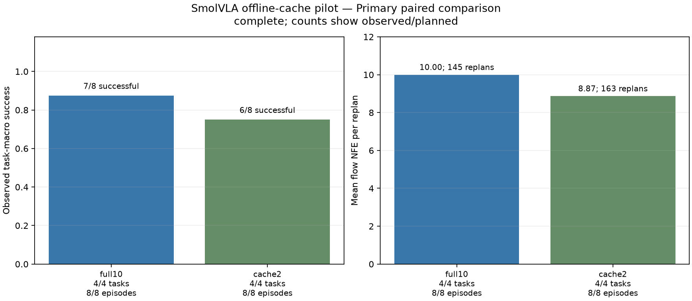
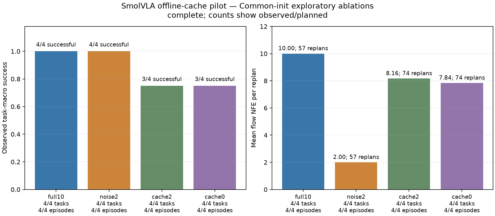
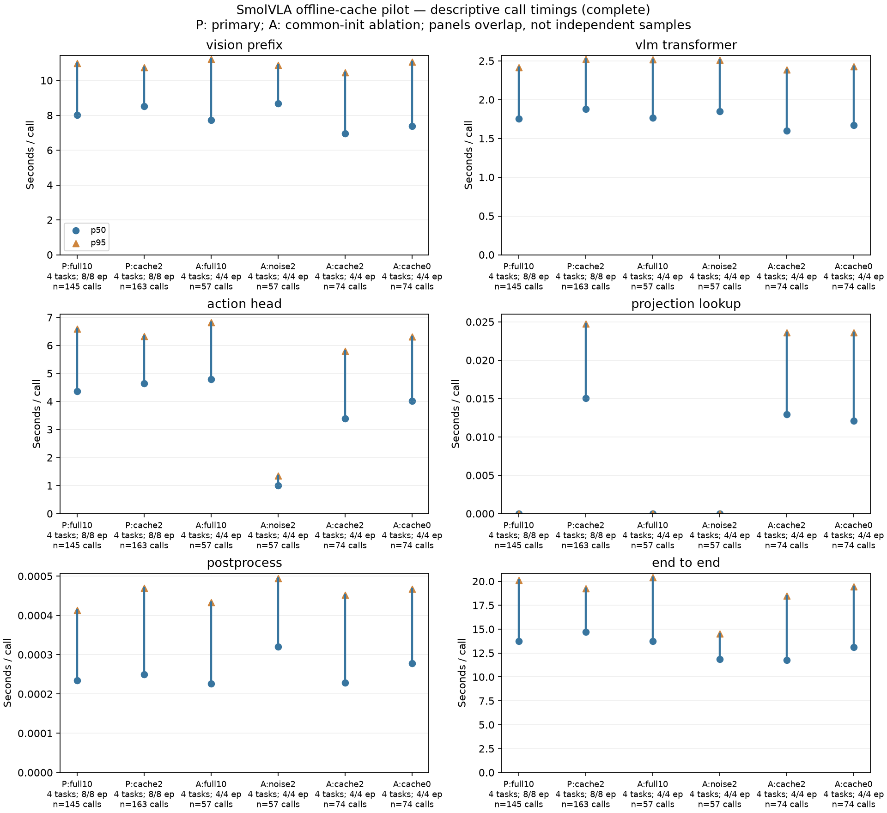

# ActionCache–SmolVLA 本机迁移研究：完整结果

截至 **2026-10-14，28 / 28 个预声明回合已完成并封存，0 缺失、0 未封存、0 运行错误**。本页依据通过只读重算校验的[正式报告](../outputs/frontier/cache_study/report.md)、[报告 JSON](../outputs/frontier/cache_study/report.json)和[检索诊断 JSON](../outputs/frontier/cache_study/retrieval_analysis.json)撰写。

**本次离线冻结缓存未建立“保持任务成功的有效加速”证据。** 主比较中，cache2 成功 **6/8**，full10 为 **7/8**；配对成功差为 **−12.50 个百分点，任务簇 bootstrap 95% 区间 [−37.50, 0.00]**。cache2 每调用 action-head NFE 从 10 降至 **8.871**，但调用数从 145 增至 163，全部主比较回合的总 NFE 仅从 1450 降至 1446。结果支持区分局部采样预算、闭环轨迹长度和任务结果，不能据此声称质量保持或普遍加速。

## 研究对象与证据范围

这是对 2026 年 [ActionCache 作者论文](https://arxiv.org/abs/2607.06370v2)思路的独立 SmolVLA 迁移：从成功开发回合提取动作生成状态，用当前多模态特征检索，再细化或直接使用缓存动作。采用**离线建库、成功开发回合准入、测试完全冻结**；与论文在线成功回合缓存及 LRU 更新机制不同，未使用作者代码，也不是其原模型和原基准的复现。2026 指研究方法时间，不表示 SmolVLA 是 2026 SOTA。归属和开放模型边界见[前沿路线](FRONTIER_LANDSCAPE.md)、[第三方说明](THIRD_PARTY.md)。

实际运行的是固定公开检查点的 **604,934,176 参数 SmolVLA，CPU / float32**；无基础模型训练、付费云计算或真机评估。每次预测 50 个动作，执行前 10 个后重规划，关闭时间集成。所有条件都计算当前观测的 VLM 前缀；NFE 仅计算 flow action head 的评估次数，不代表整个模型调用成本。

| 条件 | 动作生成方式 | 单次 NFE |
|---|---|---:|
| full10 | 当前观测条件下，从相同配对噪声走完整 10 步网格 | 10 |
| noise2 | 从噪声走覆盖完整时间区间的 2 步粗网格 | 2 |
| cache2 | 命中时取 `(50,32)` 中间 latent，沿原网格从 `t=.2` 续算最后 2 步；miss 回退 full10 | hit 2 / miss 10 |
| cache0 | 命中时取独立缓存的 `(50,7)` 最终归一化动作并正常后处理；miss 回退 full10 | hit 0 / miss 10 |

缓存使用 `d=500`、`density=.01`、seed `20261014` 的固定稀疏三元投影及全局余弦 top1 检索，不按 task ID 路由。阈值 **0.95 在回合开始前固定，未调优**。四个开发回合完成后，spatial、object、goal 成功，libero_10 失败；仅前三者的 30 个重规划样本准入，因此 cache2/cache0 **各 30 条**，容量上限 3000。失败开发数据保留，测试不更新、不淘汰、不补选样本。见[冻结协议](CACHE_PROTOCOL.md)及[缓存绑定](../outputs/frontier/cache_study/frozen_cache/binding.json)。

## 完成规模与统计单位

四个 LIBERO suite 各固定 task `1`。它们是预训练模型已知基准中的任务；本项目只隔离缓存开发与测试初态，不宣称未见任务、未见指令或上游训练数据去重后的泛化。

| 用途 | 初态 | 方法 | 实际回合 | 比较单位 |
|---|---|---|---:|---|
| 开发 / prefill | 1 | full10 | 4 | 仅用于缓存准入，3 成功、1 失败 |
| 预声明主比较 | 11、29 | full10、cache2 | 16 | 每方法 8 回合；8 组配对，嵌套于 4 个任务簇 |
| 探索消融新增条件 | 11 | noise2、cache0 | 8 | 与主比较 init11 子集组成四方法、每方法 4 回合的比较 |
| 合计 | — | — | **28** | **4 个任务簇，不是 28 个独立任务** |

消融中的 full10/cache2 来自主比较，不能将两个面板的回合数相加。所有正常超时失败均保留；没有根据结果删去任务、降低阈值或更换主比较。配对审计核对 8 个初态块的 RGB / 本体状态，以及 256 对共有决策序号的噪声 SHA；后续观测可以因动作不同而分化。

## 主比较：计算减少没有同时保持观察成功率

| 指标 | full10 | cache2 |
|---|---:|---:|
| 成功 / 完成 | 7 / 8（87.5%） | 6 / 8（75.0%） |
| 重规划调用总数 | 145 | 163 |
| action-head NFE 总数 | 1450 | 1446 |
| NFE / 调用 | 10.000 | 8.871 |
| hit / query | 不适用 | 23 / 163（14.11%） |
| 完整 10 步回退 / 调用 | 不适用 | 140 / 163 |

cache2 的每调用 NFE 减少 **11.29%**，调用数增加 **12.41%**，总 NFE 只减少 **4 次（0.28%）**。这是当前实际轨迹上的预算计数，不是固定质量下的效率收益。8 组配对中，双方成功 6 组、双方失败 1 组、full10 成功而 cache2 失败 1 组，没有 cache2 独自成功的配对。

区间采用 **2,000 次任务簇重采样，seed=20261014**：先计算每个任务内两个初态的配对差，再对四个任务等权平均。只有四个任务簇，区间是有限样本下的探索性不确定性描述；不能把 8 个配对或 308 次调用当作独立任务来缩小区间。成功差区间包含 0，也不能据此宣布等价或非劣。

## 共同 init11 的探索消融

| 方法 | 成功 / 4 | 调用总数 | 总 NFE | NFE / 调用 | hit / query |
|---|---:|---:|---:|---:|---:|
| full10 | 4 / 4 | 57 | 570 | 10.000 | 不适用 |
| noise2 | 4 / 4 | 57 | 114 | 2.000 | 不适用 |
| cache2 | 3 / 4 | 74 | 604 | 8.162 | 17 / 74 |
| cache0 | 3 / 4 | 74 | 580 | 7.838 | 16 / 74 |

noise2 在这四个配对初态上保持了观察到的 4/4 成功，且 NFE 更低；这只是预声明探索面板的结果，不将它事后改成新主方法，也不推断在 init29 或其它任务上同样有效。cache2 与 noise2 **不是相同 NFE 预算**：前者 miss 时回退 10 步。cache2 和 cache0 都在 spatial/init11 失败，其余三例成功；相同成功向量不证明两种缓存方式等价。

## 配对计时、墙钟与预算口径

下表全部为 **candidate − baseline**。调用差比较每回合 `end_to_end_seconds` 的均值，再按任务聚类；不是把不同轨迹上的所有调用混在一起直接作差。成功差单位为百分点，时间单位为秒。所有比较均有 4 个任务簇。

| 范围 / 对照 | 配对数 | 成功差 [95% CI] | 每调用均值差 [95% CI] | 双方成功配对数 | 双成功回合平均 wall 差 |
|---|---:|---:|---:|---:|---:|
| 主比较 cache2 − full10 | 8 | −12.50 [−37.50, 0.00] | −1.378 [−4.162, +0.338] | 6 | −24.182 |
| init11 cache2 − full10 | 4 | −25.00 [−75.00, 0.00] | −2.927 [−5.543, −0.688] | 3 | −59.032 |
| init11 noise2 − full10 | 4 | 0.00 [0.00, 0.00] | −3.410 [−5.770, +0.120] | 4 | −50.160 |
| init11 cache0 − full10 | 4 | −25.00 [−75.00, 0.00] | −2.375 [−4.752, +0.160] | 3 | −51.680 |
| init11 cache2 − noise2 | 4 | −25.00 [−75.00, 0.00] | +0.483 [−3.450, +4.415] | 3 | −16.226 |
| init11 cache2 − cache0 | 4 | 0.00 [0.00, 0.00] | −0.552 [−1.357, +0.621] | 3 | −7.352 |

主比较调用耗时差的区间跨 0。init11 cache2 − full10 的调用差区间虽低于 0，但同时少成功一个任务，且多个探索对照未作多重比较校正，不能据此宣称质量保持的加速。零宽成功区间仅表示这四个观察任务的成功差没有变异，不能代表真实不确定性为零。

**双成功 wall 差只使用双方成功的 6 或 3/4 个配对，是按结果条件化的描述量，未报告其置信区间。** 它排除了主比较中的独有失败，不能替代全体成功率或写成总体加速倍数。每个失败回合的完整 wall 仍保留在[回合 CSV](../outputs/frontier/cache_study/episodes.csv)。

调用池的完整耗时 p50/p95：主比较 full10 为 **13.721 / 20.118 s**（145 次），cache2 为 **14.716 / 19.262 s**（163 次）。它们与上表的配对回合均值差采用不同权重；长回合贡献更多调用，不能混作同一统计量。`end_to_end_seconds` 包括最近观测的预处理、当前 VLM、动作头、检索与后处理；将重规划间隔内其它 tick 的预处理也分摊进去时，`amortized_end_to_end_seconds` 的 p50/p95 分别为 **13.764 / 20.165 s** 与 **14.761 / 19.325 s**。

VLM 仍在每次缓存查询时执行。图中的 VLM 总项已包含 vision-prefix 与 transformer，不能再将三项相加。共享本机的负载、运行顺序和缓存状态会影响墙钟时间；这些结果不是受控吞吐 benchmark。同步仿真在推理时暂停，20 Hz 控制时间不等于真实机器人的实时执行能力。早先[单观测 CPU profile](FRONTIER_CPU_PROFILE.md)只证明真实执行及分项成本；其同观测自身 latent 续算是理想续算对照，不能替代这里的实际检索结果。

## 全部缓存回合的事后检索诊断

下表列出全部 12 个缓存测试回合，未按成功或相似度挑选。所有 task ID 均为 1；括号内为成功状态。检索分析独立于正式报告，不改变协议或模型选择。

| suite / init | cache2 hit / query；NFE | cache0 hit / query；NFE |
|---|---|---|
| spatial / 11 | 6 / 28；232（失败） | 5 / 28；230（失败） |
| spatial / 29 | 5 / 11；70（成功） | 未计划 |
| object / 11 | 11 / 12；32（成功） | 11 / 12；10（成功） |
| object / 29 | 0 / 17；170（成功） | 未计划 |
| goal / 11 | 0 / 9；90（成功） | 0 / 9；90（成功） |
| goal / 29 | 1 / 9；82（成功） | 未计划 |
| libero_10 / 11 | 0 / 25；250（成功） | 0 / 25；250（成功） |
| libero_10 / 29 | 0 / 52；520（失败） | 未计划 |

12 个缓存回合合计 **39 次命中 / 237 次查询**，39 次均来自相同 suite/task 的成功开发回合，跨任务命中为 0。每个有命中的回合，最长连续同一索引命中长度均为 **1**，且其命中条目索引未在该回合重复；当前记录不支持将失败解释为“反复检索同一条目卡住”。这不等于已确定失败原因，也不意味着同任务来源或高余弦相似度保证动作质量。逐次来源、索引、相似度及 hit 记录见[诊断 JSON](../outputs/frontier/cache_study/retrieval_analysis.json)，逐回合汇总见[诊断 CSV](../outputs/frontier/cache_study/retrieval_analysis.csv)。

**libero_10/task1 没有观察到缓存 NFE 收益。** 该任务的开发回合失败而未准入，两个 cache2 测试回合和 init11 cache0 全部 miss，共 102 次查询均执行 full10。init11 的 full10/cache2/cache0 都在 250 步成功，保存的完整动作、每步机器人状态、最终状态及 final.png 完全一致；不将此扩展为未保存的中间图像一致。尽管如此，它们的平均调用耗时和 wall 仍不同，直接说明较短墙钟不能自动归因于缓存计算节省。init29 的 full10/cache2 都达到 520 步失败，不能把 miss 回退视为任务成功保证。

**spatial/init11 是唯一的主比较独有失败。** full10 在 98 步成功，cache2 在 280 步失败；cache2 六次命中依次使用索引 0–5，其总 NFE 232 为该 full10 回合的 2.32 倍。cache0 同样失败，noise2 成功。端点图与机器人轨迹不能确定抓取、掉落或接触机制，不能将该单例升级为所有 ActionCache 方法无效。详细端点和轨迹证据见 [FA-004](FAILURE_ANALYSIS.md#fa-004缓存调用中-nfe-减少但配对回合未完成任务)。

## 首 10 个动作的一致性诊断

所有相关配对均有完整前 10 步，无缺失。首次规划使用同一初始输入与噪声，比较的是后处理后、环境内部限幅前的七维动作命令；这不是 50 动作块或 normalized latent 的误差，也没有真实最优动作标签。

| 对照 | 有效配对 | 前 10 步七维混合坐标 RMSE 的回合均值 |
|---|---:|---:|
| 主比较 cache2 − full10 | 8 / 8 | 0.006516 |
| init11 cache2 − full10 | 4 / 4 | 0.005802 |
| init11 noise2 − full10 | 4 / 4 | 0.035454 |
| init11 cache0 − full10 | 4 / 4 | 0.007353 |
| init11 cache2 − noise2 | 4 / 4 | 0.037119 |
| init11 cache2 − cache0 | 4 / 4 | 0.001662 |

七个动作通道的含义和尺度不同，混合 RMSE 仅用于描述；逐通道 RMSE/MAE 与最大绝对差保存在[配对 CSV](../outputs/frontier/cache_study/pairs.csv)。主比较 8 对中 6 对的首 10 步差为零，两个 spatial 初态非零。低动作差不能替代成功率：在 init11，cache2 比 noise2 更接近 full10 的首段动作，却少成功一个任务。首段之后的闭环状态允许分化，不据此作全程同观测动作误差比较。

## 实现验证与独立基线

真实 SmolVLA 检查点已完成上游 parity 验证：完整 10 步及捕获同观测中间 latent 后的 **8+2 原网格续算与上游逐位一致**，[实际模型测试](../artifacts/cache-sampler-real-parity.xml)为 **1 passed，89.460 s**。它验证采样路径一致性，不验证从另一个观测检索来的 latent 一定可用。[最终轻量测试记录](../artifacts/frontier-unit-tests.xml)为 **419 passed、1 skipped**；跳过的重模型测试与单独保存的真实 parity 记录应分别理解。正式报告校验与检索诊断校验均通过，包含源码、模型来源、receipt、轨迹、配对输入和噪声，以及输出与原始证据的重算一致性。

此前的 MINERVA 基线独立完成 **232 回合：40 覆盖 + 32 开发 + 128 clean 主比较/消融 + 32 delay4**。clean 中 adaptive 为 15/16、fixed8 为 16/16，平均调用增加 93.07%；delay4 为 8/16 对 7/16，成功差区间 [−18.75, +37.50] 个百分点，未建立优于对照的证据。原 248 计划中的 16 个 SmolVLA 调度/flow-step 回合暂停且未尝试，不能用本研究的 28 回合补足旧分母。详见[完整基线结果](BASELINE_RESULTS.md)。FA-001 的独立动作重放另验证了 300 步最大状态差 0.0，属于[诊断审计](../outputs/replays/fa-001/replay_audit.json)，不新增评估回合。

独立的 **VLA-JEPA 本机可行性探测**已下载并验证 6,163,212,550 字节的完整策略检查点，见[下载清单](../models/vlajepa/manifest.json)。实际尝试的[探测记录](../artifacts/frontier/vlajepa_real_probe.json)为 `blocked_preflight`：当时可用内存 6,193,487,872 字节（约 5.768 GiB），低于预先固定的 6 GiB 门槛，因此没有构造、加载模型或执行前向，也没有重试。它记录的是当时本机资源未满足既定运行条件，不证明该模型在本机原理上无法运行；不能写成真实推理成功，更不纳入本页 28 回合的任务结果。

本项目可复核的贡献是独立迁移实现、严格缓存隔离、真实上游 parity、闭环配对、预算/时延分解和保留负结果。当前小样本不支持算法首创、完整 LIBERO 基准复现、未见任务泛化、SOTA、真机效果或稳定实时加速的声明。

## 复核入口与版本绑定

[冻结协议 JSON](../outputs/frontier/cache_study/protocol.json) · [完整报告 JSON](../outputs/frontier/cache_study/report.json) · [正式 Markdown 报告](../outputs/frontier/cache_study/report.md) · [导出完整性清单](../outputs/frontier/cache_study/exports.json) · [方法汇总](../outputs/frontier/cache_study/groups.csv) · [全部回合](../outputs/frontier/cache_study/episodes.csv) · [全部调用](../outputs/frontier/cache_study/calls.csv) · [配对指标](../outputs/frontier/cache_study/pairs.csv) · [事后检索诊断](../outputs/frontier/cache_study/retrieval_analysis.json)。

| 标识 / 文件 | 指纹或 SHA-256 |
|---|---|
| 协议指纹 | `aa7226e19feef89f972207d22fc0e087b8d9e2bbd44c3761103f73e9ae821bc5` |
| protocol.json | `d6fdccfe2078323d0dffbd7e806620a1a69e8d986c2a05f06b15a9423487fe2d` |
| report.json | `7232c81fb0c2da3cdab702a4076bb53a61d0c775bb6ff1091d933f990500f873` |
| retrieval_analysis.json | `67e34ba275624cbf69c5a369edec6c2624c8daef5d73d7b2d6a531a581b27835` |
| retrieval_analysis.csv | `a1e4082df70c6fa02b6bf4d10547b62726ac1949d279859db2495ba05379ab4f` |
| SmolVLA 模型 revision | `6721902bc4d61e50a3bfdb11dfb4cb626f05d102` |
| 模型权重 | `71d9563c8295284acba8fc2d5c19de000d6fe9ba58a406832af7ef3d221ed52f` |

本页只解释上述完整封存结果，没有修改协议、冻结代码或任何原始回合。报告与检索脚本、缓存来源及每个回合 receipt 的 SHA 均保留在对应 JSON 中；结果文件重建后应重新核对本页绑定。
