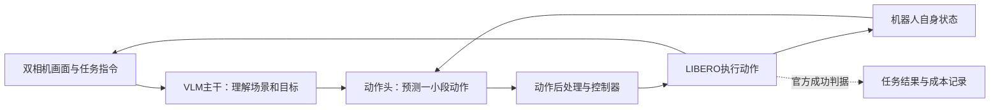

# 这个项目在做什么：VLA 还是 VLM？

**做的是 VLA（Vision-Language-Action，视觉—语言—动作）推理与闭环评测。** 模型需要根据相机画面、语言指令和机器人状态，输出能交给机械臂控制器执行的动作。VLM（Vision-Language Model，视觉语言模型）是其中理解画面与任务的主干。

项目使用公开的预训练机器人策略，在一台16GB、无NVIDIA GPU的Windows电脑上检验推理方法与运行成本，没有从零训练基础模型，也没有做真机实验。实际操作环境是LIBERO物理仿真；动作会改变模拟机械臂、物体和下一次看到的画面。

## VLM 与 VLA 的区别

| 看什么 | VLM：视觉语言模型 | VLA：视觉语言动作策略 |
|---|---|---|
| 主要输入 | 图像、文字 | 图像、任务指令，通常还包括机器人自身状态 |
| 主要输出 | 文字回答或供下游使用的特征 | 一步或一小段可执行动作 |
| 同一桌面任务的例子 | 描述黑碗在盘子旁边，解释应把碗放到哪里 | 输出机械臂移动、调整姿态、闭合夹爪等动作命令 |
| 如何检验 | 图文理解、回答或表征是否合适 | 动作执行后任务是否完成，过程与资源成本如何 |
| 在本项目中的位置 | SmolVLA、VLA-JEPA内部的图文理解主干 | 包含主干和动作头的完整策略，是研究与评测对象 |

两者不是互斥的模型标签：这里的VLA使用VLM主干，再连接动作生成部分。因此，项目会研究和优化VLM部分的计算，但最终关心的是机器人动作及其执行结果。

## 一次任务怎样运行

以项目中实际保存的仿真观测为例，语言任务是：**“拿起盘子与小碗之间的黑碗，放到盘子上。”** 模型接收桌面和手腕相机画面、机械臂/夹爪状态及这条指令。动作头输出一小段数值命令；经过官方动作后处理，再由仿真控制器执行。这些命令包括末端位置与姿态变化、夹爪开合，并非“抓住碗”这样的文字回答。

**VLM主干加动作头构成本项目的VLA策略。** 执行一小段后，系统重新取当前画面与状态，再预测下一段，这就是闭环。机械臂是否真的抓住物体、目标是否已经移动，会影响下一次输入；策略不能只在最初看一张图就忽略后续变化。

相应地，三个阶段的证据要分开：

1. **能加载模型：** 权重、结构和资源检查通过。
2. **能做一次前向：** 对一份固定观测产生符合格式的动作；动作可以尚未在环境中执行。
3. **能完成闭环任务：** 多次观察和执行，直到达到官方成功条件或预先规定的步数上限。

VLA-JEPA现在已经有第3类证据：空间、对象和目标任务各成功完成真实闭环，重复执行时动作与轨迹一致；长程任务从398步中止记录恢复到520步时限，官方判定失败，见[恢复结果](VLAJEPA_RECOVERY_RESULTS.md)。完整执行和官方成功分别记录；恢复也不是一次从头连续执行的新样本。

## 已完成什么，本轮改进什么

| 工作 | 已有证据或当前状态 | 能回答的问题 |
|---|---|---|
| SmolVLA动作缓存研究 | **28回合完成**；full10主比较7/8成功，cache2为6/8 | 缓存与少步细化有没有在这组闭环任务中改善成功和计算的权衡？结果未支持原假设 |
| SmolVLA两步采样前瞻确认 | **另16回合完成**，8配对、4任务簇；full10 4/8、noise2 5/8，总动作头求值次数（NFE）为2050、370 | 旧探索中发现的少步方案，在预先冻结的新初态上表现如何？有限样本不证明普遍优越或非劣 |
| VLA-JEPA动态INT8 | **一次实际观测前向通过**；300个量化线性层实际执行，单次前向约6.954秒，1秒采样最高进程内存（RSS）约3.521GiB | 这个明确改变数值实现的变体，能否在本机加载并产生通过检查的动作块？ |
| VLA-JEPA原生BF16 | 两次入口因可用内存低于固定6GiB门槛退出，未执行前向 | 记录当次资源限制；不证明这台机器在所有资源状态下都不能运行原生路径 |
| VLA-JEPA分页存储 | 完整BF16词表以私有文件映射承载；单观测模型动作与环境动作均与原INT8逐值相等 | 存储布局改变后，这个观察上的输出能否保持？不能外推所有输入或原生BF16等价 |
| **VLA-JEPA真实闭环** | [compact](VLAJEPA_COMPACT_RESULTS.md)和[每任务独立进程](VLAJEPA_ISOLATED_RESULTS.md)各完成空间109步、对象128步、目标90步，三个任务均官方成功；两阶段长程任务均触发5.5GiB自身RSS保护 | 本机已能持续执行真实VLA策略；隔离进程仍不足以满足长程任务的5.5GiB预算 |
| 单长程任务资源实验 | [原6GiB尝试](VLAJEPA_LONG_HORIZON_RESULTS.md)执行398步后因系统余量不足中止；后继[恢复](VLAJEPA_RECOVERY_RESULTS.md)在额外资源准备后到达520步，官方任务失败 | 完成中断轨迹的连续性验证；原尝试仍未封存，恢复不新增独立样本，不与旧三成功拼成同协议4/4 |

本轮的4回合是小规模可行性评估，不是完整LIBERO基准。初态41已用于此前SmolVLA研究，不能再称作整个项目从未用过的新初态。模型、每次执行的动作数等设置也不同，因此这轮不能直接证明VLA-JEPA优于或劣于SmolVLA；更不能证明量化相对原生BF16没有质量损失，因为本机没有原生前向对照。

**28、16和每个VLA-JEPA资源阶段分别记录。** 更早的MINERVA **232回合**是以任务ID为条件的反馈调度基线，不把它写成语言条件VLA的新实验，也不把不同模型或预算的回合拼成一个成功率。

已有研究见[v1结果](RESULTS.md)、[前瞻确认结果](CONTINUATION_RESULTS.md)；量化实现与单次前向证据见[CPU VLA-JEPA INT8说明](CPU_VLAJEPA_INT8.md)。原始owned存储阶段的[四次入口阻断](VLAJEPA_CLOSED_LOOP_RESULTS.md)、后续分页阶段中止及各闭环阶段均保留，后来的成功不改写早期结果。

接口的[47项历史测试](../artifacts/vlajepa-closed-loop-interface-tests.xml)含3项真实微型PyTorch动态INT8检查；后续[分页101项](../artifacts/vlajepa-paged-tests-20261016.xml)、[arena与compact 79项](../artifacts/vlajepa-compact-tests-20261016.xml)、[进程隔离22项](../artifacts/vlajepa-isolated-tests-20261016.xml)、[单长任务30项](../artifacts/vlajepa-long-horizon-tests-20261016.xml)分别保存，各批次不加总，也不是机器人任务次数。真实模型回合另有逐调用、动作、状态和封存凭据。

## 项目重点与求职价值

研究问题是：**冻结的公开VLA，怎样在有限计算和内存下运行，改变推理方式后任务结果会发生什么？** 项目已经比较动作缓存、减少动作采样步数，并尝试更低内存的数值实现。每项改动都需要同时检查模型调用、任务结果和实际成本；减少动作头计算并不自动减少完整模型延迟。

可以具体展示的能力包括：

- **接通机器人策略：** 对齐双相机、语言、机器人状态、动作归一化和控制器，让预测动作真正进入物理仿真。
- **设计可检验的实验：** 区分探索与确认，提前固定模型、任务、初态和统计规则，保留失败以及完整步数上限。
- **分析推理开销：** 分开记录图文主干、动作头、加载与仿真时间；用内存采样和流式加载处理单机约束。
- **判断证据够不够：** 区分一次前向、动作重放、真实闭环和完整基准；报告负结果，不把低计算量直接写成加速或质量保持。
- **让别人复查：** 保存来源、协议、逐回合动作与状态、图像、计时和文件哈希，让结果能追溯到实际执行。

VLA-JEPA的INT8方案使用动态INT8 Linear、BF16 embedding存储并将其输出转为FP32，其余推理部分为FP32。它是一种单独记录的数值变体，不等于重新训练了更强的基础模型；原模型、权重、任务和方法思想的贡献归属上游。面试中的项目介绍可以是：**“单机CPU上的预训练VLA推理与闭环评测：从缓存负结果、少步采样确认，到量化模型的环境接入。”** 具体参与范围和研究限制仍应如实说明，详见[项目展示指南](PORTFOLIO_GUIDE.md)。
