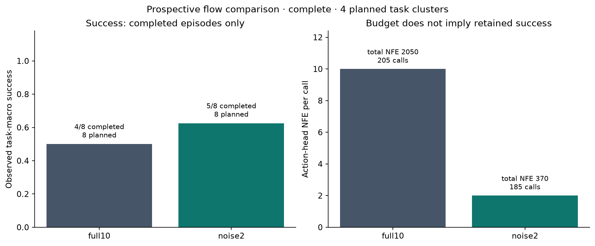
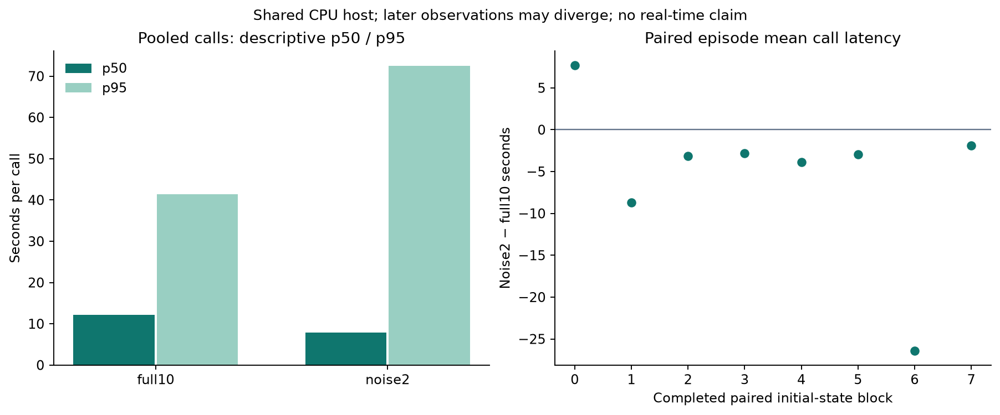

# SmolVLA prospective full10 versus noise2 confirmation v2 — 完整结果

Does two-step sampling from fresh noise retain success while reducing flow NFE on fresh initial states?

已核验 **16/16** 回合；缺失 0、未封存 0、运行错误 0。计划为 **8 组配对、4 个任务簇**。

本次假设来自 v1 的探索结果：noise2 在共同 init11 的四个任务上成功。新试验预先固定 init41/43，不与 v1 合并分母，也不代表上游预训练未见这些初态。

full10 与 noise2 都在当前观测条件下，从相同配对噪声覆盖完整 flow 时间区间，分别执行10步和2步。没有缓存读取、latent 续算或模型训练；两者每次生成50动作并执行前10个后重规划。

## 成功与计算预算

| 方法 | 完成 / 计划 | 成功 / 已完成 | 调用总数 | 总 NFE | NFE / 调用 |
|---|---:|---:|---:|---:|---:|
| full10 | 8/8 | 4/8 | 205 | 2050 | 10.000 |
| noise2 | 8/8 | 5/8 | 185 | 370 | 2.000 |

NFE 仅计 action head；两种方法都执行当前观测的 VLM。总 NFE 同时受每调用预算和回合调用数影响。

## 预声明配对比较：noise2 − full10

完成 **8/8** 配对，覆盖 **4/4** 个任务簇。

| 指标 | 任务等权配对差 | 任务簇 bootstrap 95% 区间 |
|---|---:|---:|
| 成功差（百分点） | 12.500 | [0.000, 37.500] |
| 每调用平均耗时差（秒） | -5.253 | [-10.743, -1.225] |
| 回合调用数差 | -2.500 | [-7.125, 0.000] |
| 回合总 NFE 差 | -210.000 | [-350.000, -104.500] |

先计算同任务两初态的配对差，再对四个任务等权平均；2,000次重采样，seed=20261015。仅四个任务簇，区间不稳定。区间含0或零宽都不证明等价、非劣或真实不确定性为0。

双方成功配对 **4** 组，其回合 wall 平均差 **-111.436 秒**。这是按结果筛选后的描述量，不给置信区间，不作为总体加速倍数。全部失败与成功回合 wall 都保留在 CSV。

调用池的分位数与配对回合均值采用不同权重，不能混用。共享主机负载及后续轨迹分化影响耗时；同步仿真在推理时暂停，不能从20 Hz控制频率推断本机实时执行。

## 初始输入、噪声与动作诊断

配对核对初始正面/手腕图像、机器人状态、环境与调度配置，并核对所有共有决策序号的噪声 SHA。后续观测允许因动作不同而分化；首10步比较的是后处理后、环境内部限幅前的动作命令。

首10步动作诊断有效 **8** 对、缺失 **0** 对。混合七维坐标 RMSE 的回合均值为 **0.036213**；逐通道指标见 pairs.csv。不足10步时标为缺失，仍保留成功结果；不将动作距离解释为任务质量或完整50动作块误差。

## 全部计划回合

| Suite / 初态 | 方法 | 状态 | 成功 | 步数 | 调用数 | 总 NFE |
|---|---|---|---:|---:|---:|---:|
| libero_spatial / 41 | full10 | complete | 1 | 93 | 10 | 100 |
| libero_spatial / 41 | noise2 | complete | 1 | 94 | 10 | 20 |
| libero_spatial / 43 | noise2 | complete | 0 | 280 | 28 | 56 |
| libero_spatial / 43 | full10 | complete | 0 | 280 | 28 | 280 |
| libero_object / 41 | noise2 | complete | 1 | 126 | 13 | 26 |
| libero_object / 41 | full10 | complete | 0 | 280 | 28 | 280 |
| libero_object / 43 | full10 | complete | 1 | 162 | 17 | 170 |
| libero_object / 43 | noise2 | complete | 1 | 123 | 13 | 26 |
| libero_goal / 41 | full10 | complete | 1 | 85 | 9 | 90 |
| libero_goal / 41 | noise2 | complete | 1 | 79 | 8 | 16 |
| libero_goal / 43 | noise2 | complete | 1 | 83 | 9 | 18 |
| libero_goal / 43 | full10 | complete | 1 | 85 | 9 | 90 |
| libero_10 / 41 | noise2 | complete | 0 | 520 | 52 | 104 |
| libero_10 / 41 | full10 | complete | 0 | 520 | 52 | 520 |
| libero_10 / 43 | full10 | complete | 0 | 520 | 52 | 520 |
| libero_10 / 43 | noise2 | complete | 0 | 520 | 52 | 104 |

## 证据与限制

[协议](protocol.json) · [报告 JSON](report.json) · [分组](groups.csv) · [回合](episodes.csv) · [配对](pairs.csv) · [调用](calls.csv)

报告绑定协议、原始证据、冻结源码和报告实现 SHA；exports.json 在全部导出完成后最后写入。只读校验会重新计算统计量、Markdown 与 CSV，并核对所有导出文件哈希。

未完成数据不会补值或并入完整结论。已有成功/失败不能用于改选任务、初态、方法或提前终止。本项目不声称算法首创、完整LIBERO复现、SOTA、未见任务泛化或真机效果。
