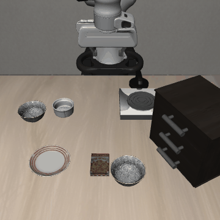
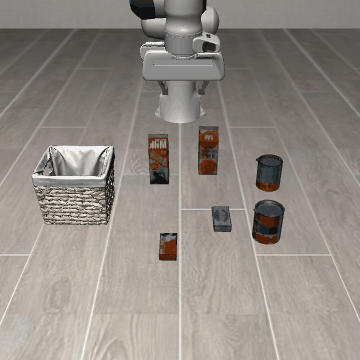
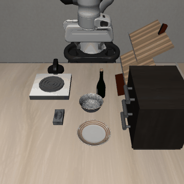

# VLA-JEPA INT8 四任务闭环诊断

计划 **4** 回合，已完成 **3**，官方成功 **3**，完整运行但任务失败 **0**。
运行完成与任务成功分别计数。缺失、未封存及错误见 report.json；本报告不填补或排除这些计划回合。

固定四个已知任务、各 init41，一次量化实现；没有原生 BF16 对照，不能估计量化损失或泛化能力，也不是与 SmolVLA 的匹配比较。

| Suite | 官方成功 | 步数 / 时限 | 规划次数 | 动作头 NFE | 推理总秒数 | 回合墙钟秒数 |
|---|---:|---:|---:|---:|---:|---:|
| libero_spatial | True | 109 / 280 | 16 | 64 | 71.614 | 109.600 |
| libero_object | True | 128 / 280 | 19 | 76 | 79.288 | 106.920 |
| libero_goal | True | 90 / 300 | 13 | 52 | 53.162 | 79.410 |

推理时仿真暂停；20 Hz 为模拟控制频率，不是模型推理速度。墙钟包含 reset、控制、物理和渲染，排除模型加载与 GIF 编码。共享主机计时不代表稳定部署吞吐。

## 运行与内存记录

- [运行原始记录](runs/run_0001.json)：`stopped_after_requested_limit`；每秒采样峰值 RSS `5361295360` bytes，最低系统可用内存 `1058787328` bytes。采样不能保证捕获瞬时峰值。
- [运行原始记录](runs/run_0002.json)：`stopped_after_requested_limit`；每秒采样峰值 RSS `5351088128` bytes，最低系统可用内存 `1121914880` bytes。采样不能保证捕获瞬时峰值。
- [运行原始记录](runs/run_0003.json)：`stopped_after_requested_limit`；每秒采样峰值 RSS `5028343808` bytes，最低系统可用内存 `1296556032` bytes。采样不能保证捕获瞬时峰值。
- [运行原始记录](runs/run_0004.json)：`running_episodes`；每秒采样峰值 RSS `None` bytes，最低系统可用内存 `None` bytes。采样不能保证捕获瞬时峰值。
- [运行原始记录](runs/run_0004.memory_stop.json)：`stopped_memory_guard`；每秒采样峰值 RSS `None` bytes，最低系统可用内存 `None` bytes。采样不能保证捕获瞬时峰值。

## 实际调用延迟分布

| Suite | 前向 p50 秒 | 前向 p95 秒 |
|---|---:|---:|
| libero_spatial | 4.183 | 5.707 |
| libero_object | 4.069 | 4.678 |
| libero_goal | 3.924 | 4.824 |
## libero_spatial

pick up the black bowl next to the ramekin and place it on the plate

[原始结果](episodes/vlajepa_isolated__libero_spatial__1__41__clean__native4_chunk7/result.json) · [逐调用记录](episodes/vlajepa_isolated__libero_spatial__1__41__clean__native4_chunk7/calls.json) · [轨迹](episodes/vlajepa_isolated__libero_spatial__1__41__clean__native4_chunk7/trajectory.npz)

## libero_object

pick up the cream cheese and place it in the basket

[原始结果](episodes/vlajepa_isolated__libero_object__1__41__clean__native4_chunk7/result.json) · [逐调用记录](episodes/vlajepa_isolated__libero_object__1__41__clean__native4_chunk7/calls.json) · [轨迹](episodes/vlajepa_isolated__libero_object__1__41__clean__native4_chunk7/trajectory.npz)

## libero_goal

put the bowl on the stove

[原始结果](episodes/vlajepa_isolated__libero_goal__1__41__clean__native4_chunk7/result.json) · [逐调用记录](episodes/vlajepa_isolated__libero_goal__1__41__clean__native4_chunk7/calls.json) · [轨迹](episodes/vlajepa_isolated__libero_goal__1__41__clean__native4_chunk7/trajectory.npz)

