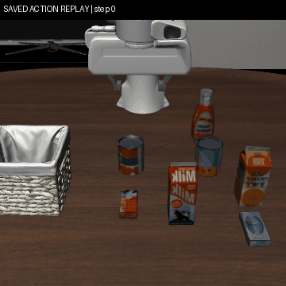

# Interrupted VLA-JEPA trajectory recovery

Independent new benchmark episodes: **0**.
Planned recovery: **1**; completed: **1**; official task successes: **0**; full-horizon task failures: **1**.
The original interrupted attempt remains unsealed. This recovery does not form a new four-of-four experiment.

- Logical trajectory: 520 / 520 steps.
- Saved-action replay: 392 steps; recomputed overlap checked against the original: 6 steps.
- Newly executed continuation: 122 steps; boundary forward recomputed once; subsequent new forwards: 18.
- Recovery wall time: 175.340s, including reset/replay/recomputation/continuation; model loading and GIF encoding excluded.
- Timing segments: `{"boundary_and_overlap_seconds": 6.39320810000936, "new_continuation_seconds": 93.1738891999994, "reset_and_replay_seconds": 75.7732418999949}`.

[Result](episodes/vlajepa_recovery__libero_10__1__41__clean__native4_chunk7/result.json) · [Recovery proof](episodes/vlajepa_recovery__libero_10__1__41__clean__native4_chunk7/recovery.json) · [Boundary](episodes/vlajepa_recovery__libero_10__1__41__clean__native4_chunk7/boundary.json)

## Run and loading evidence

- [Run](runs/run_0001.json): `blocked_preflight`; loading Nones; memory `{}`.
- [Run](runs/run_0002.json): `blocked_preflight`; loading Nones; memory `{}`.
- [Run](runs/run_0003.json): `blocked_preflight`; loading Nones; memory `{"minimum_available_bytes": 6066372608, "peak_rss_bytes": 573874176, "sampling_seconds": 1.0}`.
- [Run](runs/run_0004.json): `blocked_preflight`; loading Nones; memory `{"minimum_available_bytes": 6142394368, "peak_rss_bytes": 575172608, "sampling_seconds": 1.0}`.
- [Run](runs/run_0005.json): `blocked_preflight`; loading Nones; memory `{}`.
- [Run](runs/run_0006.json): `complete`; loading 63.48027820000425s; memory `{"minimum_available_bytes": 1011326976, "peak_rss_bytes": 5700780032, "sampling_seconds": 1.0}`.

## Limitations

- changed numerics, no original BF16 comparison or quantization quality attribution
- different checkpoint, action interval and source from SmolVLA; not a matched comparison
- simulation pauses during inference; no real robot or real-time control claim
- all successes, task failures, incomplete and runtime errors retained separately
- Separate paging experiment; does not complete the frozen owned-embedding stage
- One-observation exact action equality does not prove all-input equivalence
- Independent successor to the interrupted paged-only attempt; all earlier failures retained
- One selected previously used task and initial state; exploratory resource feasibility, not generalization
- Independent one-case protocol and budget; cannot combine previous successes into a four-of-four experiment
- Every earlier interrupted attempt remains retained separately; no automatic retry of unsealed evidence
- Frozen engine stdout may display [1/4]; this protocol and all saved reports/progress plan exactly one case
- Frozen LIBERO reset may swallow repeated native-warning exceptions; a hung reset requires external timeout
- Recovery of an existing interrupted trajectory, not a new independent evaluation sample
- Exact observable robot states and both camera hashes do not prove equality of unrecorded full MuJoCo internal state
- Prefix replay and one repeated boundary forward are included in recovery wall time; original timing is not synthesized
